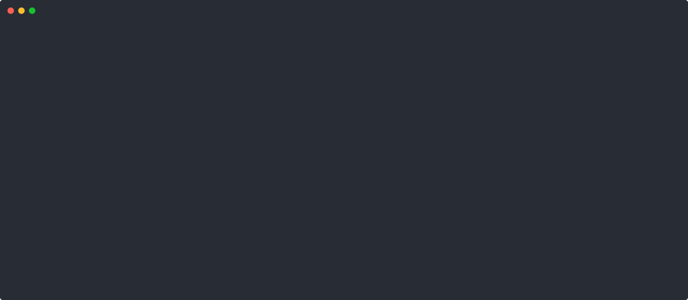
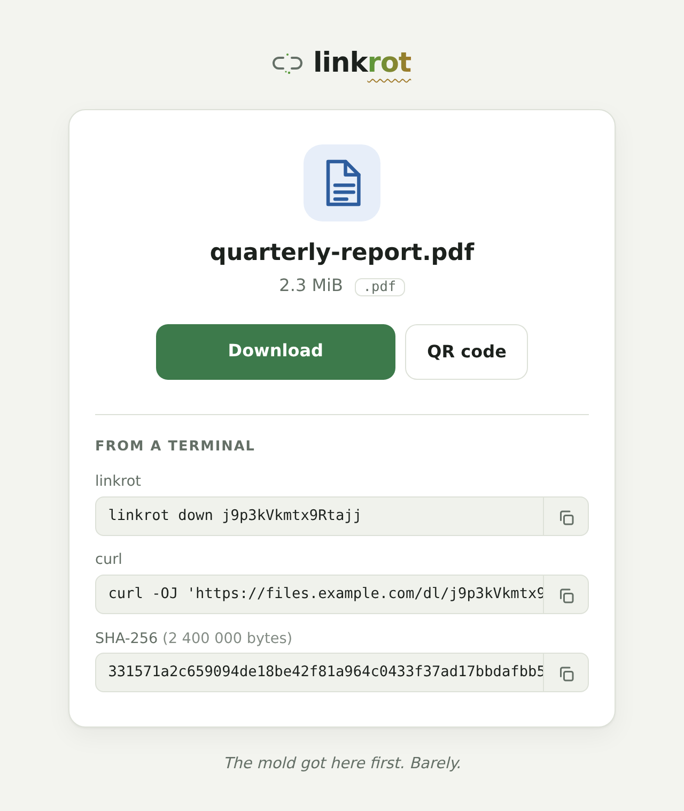
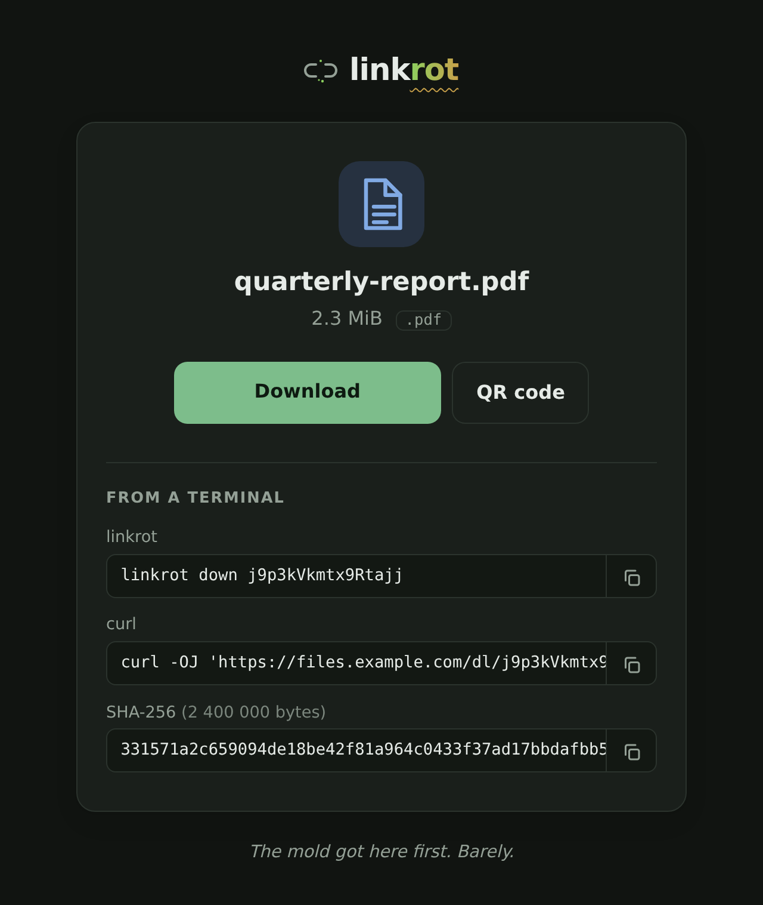
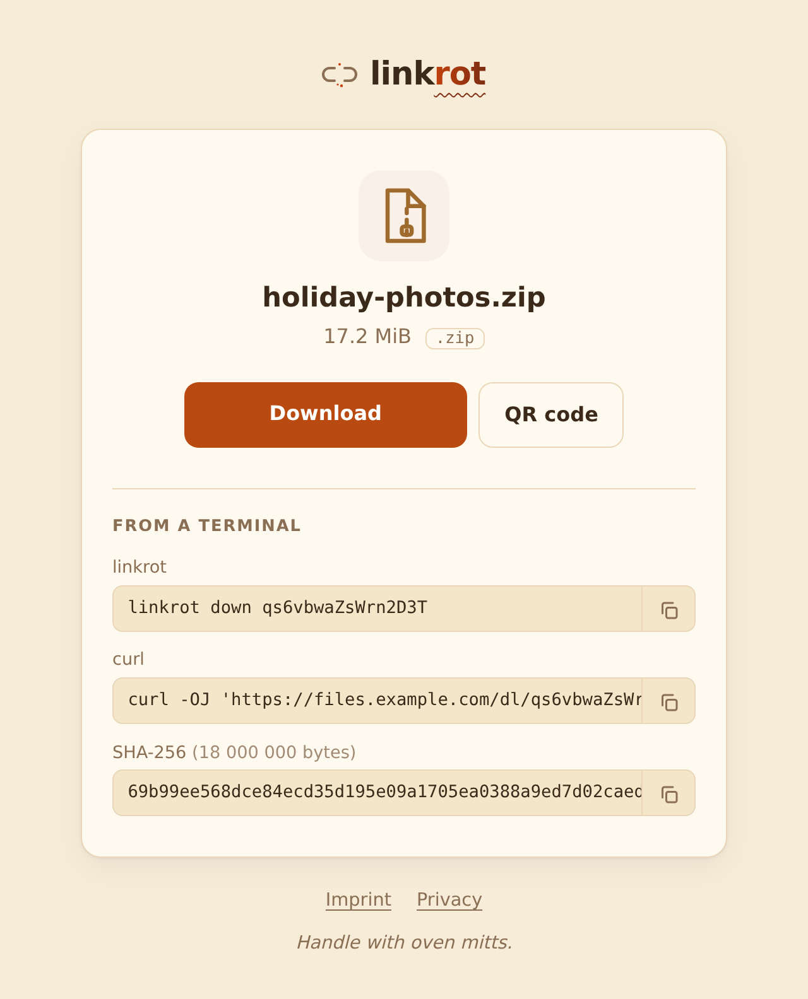
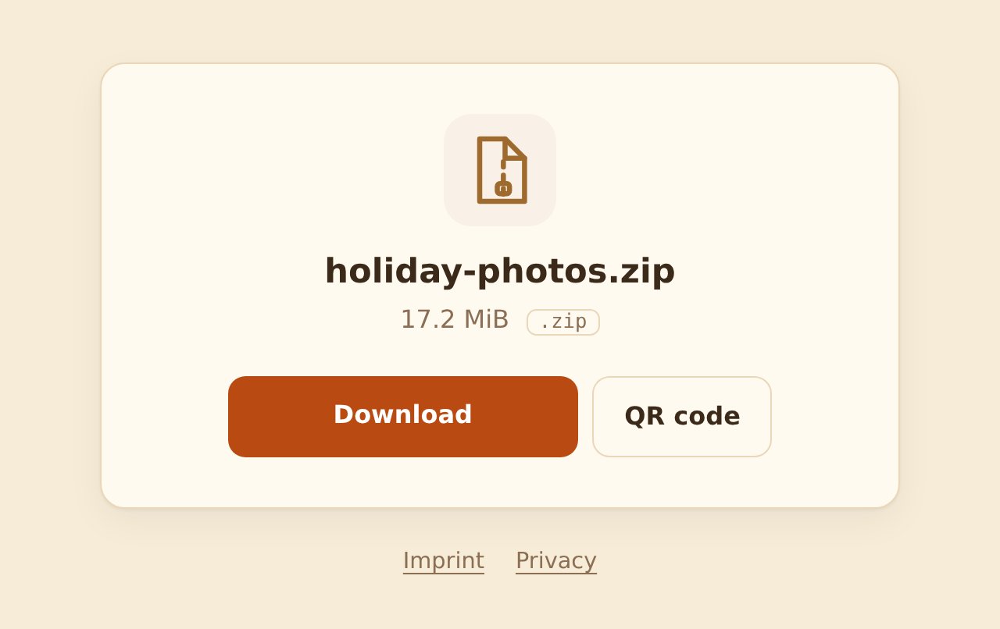
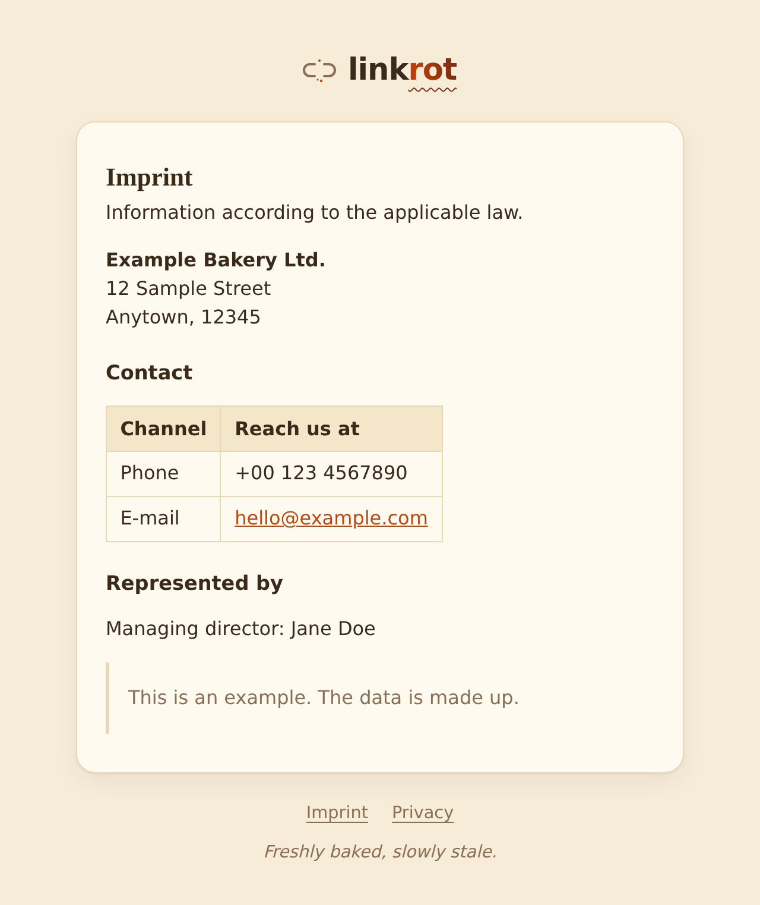
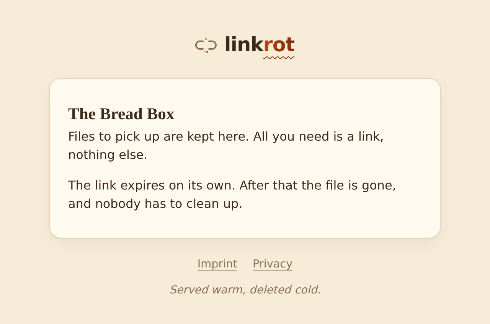

# Linkrot

**Share a file from the terminal. The link rots on its own.**

<p align="center">
  
</p>

You have a file. Somebody needs it. You do not want to make an account, drag anything into a browser tab, or remember to
clean up afterwards. So: one command, one URL on stdout, and entropy does the rest. After the time you picked (or the
number of downloads you allowed), the link stops working and the file is gone. Like leftovers, but you never have to open
the fridge.

```
$ lr up report.pdf --rm-after 2d
https://files.example.com/file/pwzhpaykdZ9Y6KbJ/report.pdf
```

*The recording is a real session with the real CLI against a local server; its address is shown as
`files.example.com`. `make showcase` makes it again, together with the screenshots below.*

## What it looks like

The page a link opens: the file, a download button, a QR code for the phone, and the commands to fetch it from a terminal
(each with a copy button). Light and dark, depending on your system:

<table>
  <tr>
    <td></td>
    <td></td>
  </tr>
</table>

### Make it yours

One installation serves any number of hosts, and every host can look like its own thing, through the API and `lr`, no
admin panel required: colors with a stylesheet (`lr custom edit css`), taglines of your own, six on/off switches, and
Markdown pages for the footer: an imprint, a privacy notice, whatever the law or your mood requires. A page can even
take over the start page.

<table>
  <tr>
    <td></td>
    <td></td>
  </tr>
  <tr>
    <td align="center">own colors, own taglines, footer links</td>
    <td align="center">the same page, stripped down with switches</td>
  </tr>
  <tr>
    <td></td>
    <td></td>
  </tr>
  <tr>
    <td align="center">an imprint, written in Markdown</td>
    <td align="center">a start page of your own</td>
  </tr>
</table>

The second picture is the first one with five of the six switches off. Each one hides one thing, on every page of the host:

- `show_taglines`: the tagline at the bottom of the pages, and the `X-Rot` header of downloads
- `show_title`: the "linkrot" headline with the logo
- `show_linkrot_line`: the `linkrot down` line of the download page
- `show_curl_line`: the curl line of the download page
- `show_hash_line`: the SHA-256 line of the download page

With the last three off the whole "From a terminal" section disappears, as in the picture. The sixth switch,
`show_startpage`, turns `/` into an empty page, for a host that only hands out links. All of them are on by default and
change with `lr config set`, for example `lr config set taglines off title off curl-line off`.

Editing is meant to be pleasant: `lr page edit imprint` opens the page in your `$VISUAL` / `$EDITOR`, watches the file and
uploads it every time you save, so you can refresh the browser and see what you did.

## What it has, and what it has not

**It has**

- **Resumable uploads.** Files travel in chunks (32 MiB by default), each one verified with its own SHA-256, and the whole
  file is verified at the end. A lost connection costs one chunk, not the evening.
- **Pipes.** `pg_dump db | gzip | lr up --mv db.sql.gz` works; the hash is sent at the end.
- **Expiry, and a download limit.** Pick a lifetime from `1h` up (the server has a mandatory maximum) and optionally a
  number of downloads. Expired files act as not found immediately, even before the cleanup removes them.
- **Duplicate detection.** The same bytes twice give you the existing link.
- **Downloads from the terminal**, with resume, verification and a promise never to overwrite your files: `lr down`.
- **One user, many devices.** Every device has its own token; a lost laptop costs you one `lr-auth del`.
- **Many hosts per installation**, each with its own tokens, files, quota and cleanup.
- **Pages you can shape:** colors, taglines, the `X-Rot` header lines, Markdown pages with strict rendering (no raw HTML),
  an imprint link on every page, a start page of your own.
- **A terminal that behaves.** Results on stdout, progress on stderr, `--json`, `-q` for scripts.
- **Extensive tab completion** for bash, zsh and fish, even for your remote files: `lr down <TAB>` lists the ids on the
  server with their file names, `lr page edit <TAB>` your pages, `lr config set <TAB>` the settings.
- **Plain parts.** PHP 8.4 and SQLite behind nginx on the server, one static Go binary for the client (Linux, macOS,
  Windows, FreeBSD), signed release artifacts.

**It has not (on purpose)**

- **Accounts.** There is no login, no registration and no sharing between users. You are the account.
- **A web upload form or an admin UI.** Uploads come from the CLI; settings come from the CLI. Browsers only download.
- **Folders.** A file is a file; for a directory, `tar czf - dir | lr up`.
- **Encryption of your content.** The server sees what you upload. If that matters, encrypt first
  (`age -p secret.txt | lr up --mv secret.txt.age`); the id in the link is the only secret on the public side.
- **Password-protected links, previews, thumbnails or virus scanning.**
- **Statistics, notifications or download history.** You can see how many downloads are left, not who took them.
- **Other storage than the local disk,** and no clustering: it is one PHP application on one SQLite file per host.
- **Minutes or seconds.** The smallest lifetime is one hour.
- **A cron job or any other scheduler.** The cleanup runs lazily, after the response, when a request comes in.

The small print (what resumes and what does not, what `--uses` really is, how far a stylesheet can reach, what was only tested
on Linux) is written down in one place for each side: [client](docs/CLI.md#limits-and-caveats) and
[server](docs/SERVER.md#limits-and-caveats).

## Quick start

The client:

```
tar -xzf linkrot_<version>_linux_amd64.tar.gz
install -m 0755 linkrot ~/.local/bin/linkrot && ln -s linkrot ~/.local/bin/lr

lr config --server https://files.example.com --token <token>
lr up report.pdf
```

The server, shortened (the whole story, nginx included, is in [docs/DEPLOYMENT.md](docs/DEPLOYMENT.md)):

```
tar -xzf linkrot-server-<version>.tar.gz -C /srv/linkrot
sudo -u www-data /srv/linkrot/app/install.sh
sudo -u www-data /srv/linkrot/app/install.sh --add-host files.example.com
printf '<?php\nreturn [];\n' | sudo -u www-data tee /srv/linkrot/app_data/files.example.com/config.php
sudo -u www-data LINKROT_HOST=files.example.com /srv/linkrot/app/bin/lr-auth get my-laptop
```

## Principles

- **One user, many devices.** There is no user management: no login, no registration, no password, no email, no
  admin UI, no web upload. The server offers public download links and a token-guarded API. All tokens belong to
  the same (single) user; they exist so each device can have its own token. A compromised token is revoked by
  deleting just that token, nothing else needs rotating.
- **Links rot.** Every file has an expiry, and optionally a maximum number of downloads. Expired files behave as
  not found even if the cleanup has not yet physically removed them.
- **No scheduler.** The server is a classic PHP request/response application without cronjob. Cleanup runs lazily,
  piggybacking on incoming requests (see [docs/SERVER.md](docs/SERVER.md)).
- **One installation, many hosts.** Every hostname listed in `app_data/global-config.php` is a tenant of its own:
  own tokens, files, database, quota and cleanup (see [docs/SERVER.md](docs/SERVER.md#tenants)). The share URL of a
  host is `https://<host>`, nothing to configure.
- **Customizable per host, through the API only.** Six on/off settings (taglines, start page, headline, and the three
  command lines of the download page) and three files (taglines, `X-Rot` header lines, a stylesheet) change how the
  public pages look, and up to 20 Markdown pages (an imprint, a privacy notice) are linked in the footer of every page.
  `lr config`, `lr custom` and `lr page` manage them, and `lr page edit` / `lr custom edit` open a file in your editor and upload it on every save; there is still no admin UI.
- **Resumable uploads.** Files are uploaded in small chunks (default 32 MiB) that are individually verified, so
  a lost connection costs at most one chunk.
- **Downloads are guarded.** Files never live in the public folder; PHP decides, nginx sends (`X-Accel-Redirect`).
- **Terminal friendly.** Results go to stdout, progress and messages to stderr, `--json` where it makes sense,
  shell completion for bash, zsh and fish.

## Documentation

| Document | Content |
| --- | --- |
| [docs/SERVER.md](docs/SERVER.md) | server architecture, layout, tenants, data model, cleanup, locking, rate limiting, appearance (settings and custom files), security, configuration, `lr-auth` |
| [docs/API.md](docs/API.md) | HTTP API: upload protocol, file management, settings, custom files, static pages, public URLs, errors |
| [docs/CLI.md](docs/CLI.md) | CLI commands (`up`, `ls`, `config`, `custom`, `page`, ...), flags, config file, exit codes, completion |
| [docs/DEPLOYMENT.md](docs/DEPLOYMENT.md) | installing a release: server tarball, nginx, tokens, CLI binaries, upgrading |
| [docs/DEVELOPMENT.md](docs/DEVELOPMENT.md) | repository layout, tooling, Makefiles, pre-commit hook, conventions, the README images |
| [docs/nginx.conf.example](docs/nginx.conf.example) | nginx server block snippet |

## Repository layout

```
server/            PHP application (see docs/SERVER.md)
cli/               Go client (see docs/CLI.md)
docs/              documentation; docs/img the images of this README, docs/showcase what makes them
.githooks/         versioned git hooks (activated by `make install-hooks`)
Makefile           delegates to server/ and cli/
```

## Decisions at a glance

| Topic | Decision |
| --- | --- |
| Public file id | 16 random characters, first 4 lowercase, lookalikes `1 0 l o I O` removed (see [SERVER.md](docs/SERVER.md#identifiers)). No uuid, no sqids. |
| Upload | sequential chunks, each chunk followed by its own sha256, whole-file sha256 verified at completion |
| Streaming upload | `lr up` reads stdin when no file is given (refused on a terminal): created without size and hash, same verified chunks, sealed with the sha256 of everything (see [API.md](docs/API.md#streaming-uploads)) |
| Duplicate uploads | refused; the existing file is reported |
| Expiry | `rm-after` counts from upload completion (`up`) or from now (`set`); capped by a mandatory server-side maximum |
| Download limit | optional `--uses n`; exhausted files count as expired |
| Public URL | `https://<host>` from `global-config.php`; plain `http://` with the request's port only for `localhost` and `127.x` (development). No `base_url` setting |
| Settings | six booleans per host, all on by default, stored in the host's database, changed with `lr config set` (see [API.md](docs/API.md#get-settings-patch-settings---the-look-of-the-public-pages)) |
| Custom files | `taglines`, `headerlines` and `css` per host, replaced with `lr custom put`; the built-in version is served but never written to disk until an upload; a replaced stylesheet stays reachable for a day (see [API.md](docs/API.md#getputdelete-customname---files-that-replace-the-built-in-look)) |
| Static pages | Markdown with a small strict head (`title`, `link`, `order`, `published`, `lang`), rendered once at upload with `league/commonmark`, no raw HTML, https and data images; the original is kept and downloadable; linked in the footer of every page, or, with `replaces_startpage: true`, shown at `/` instead of the about page (see [API.md](docs/API.md#get-pages-getputdelete-pagesname-get-page-template---static-pages)) |
| Cleanup | lazy, on requests, guarded by `flock`; also triggerable with `linkrot cleanup` |
| Rate limiting | own limiter on failed authentication, stored in APCu, keyed by hashed client IP |
| Tokens | only hashes stored; named per device; `lr-auth get\|del\|ls` |
| Quality gates | phpstan level 7, rector, php-cs-fixer, phpunit; Go: `go vet`, `golangci-lint`, `gofumpt`, `go test`; pre-commit hook runs `make precommit` |

## License

Copyright (C) 2026 Schorsch3000

Linkrot is free software: you can redistribute it and/or modify it under the terms of the GNU General Public License as
published by the Free Software Foundation, either version 3 of the License, or (at your option) any later version. It is
distributed in the hope that it will be useful, but WITHOUT ANY WARRANTY; without even the implied warranty of
MERCHANTABILITY or FITNESS FOR A PARTICULAR PURPOSE. See [LICENSE](LICENSE) for the full text. Every release archive
contains it.

The dependencies keep their own licenses, all compatible with the GPL: `bacon/bacon-qr-code` (BSD-2-Clause),
`dasprid/enum` (BSD-2-Clause), `league/commonmark` and `league/config` (BSD-3-Clause), `dflydev/dot-access-data` (MIT),
`nette/schema` and `nette/utils` (BSD-3-Clause or GPL), `psr/event-dispatcher` and the `symfony` polyfill and contracts (MIT),
`spf13/cobra` and `spf13/pflag` (Apache-2.0 / BSD-3-Clause), `pelletier/go-toml`
(MIT), `inconshreveable/mousetrap` (Apache-2.0). Development tools are not shipped.
